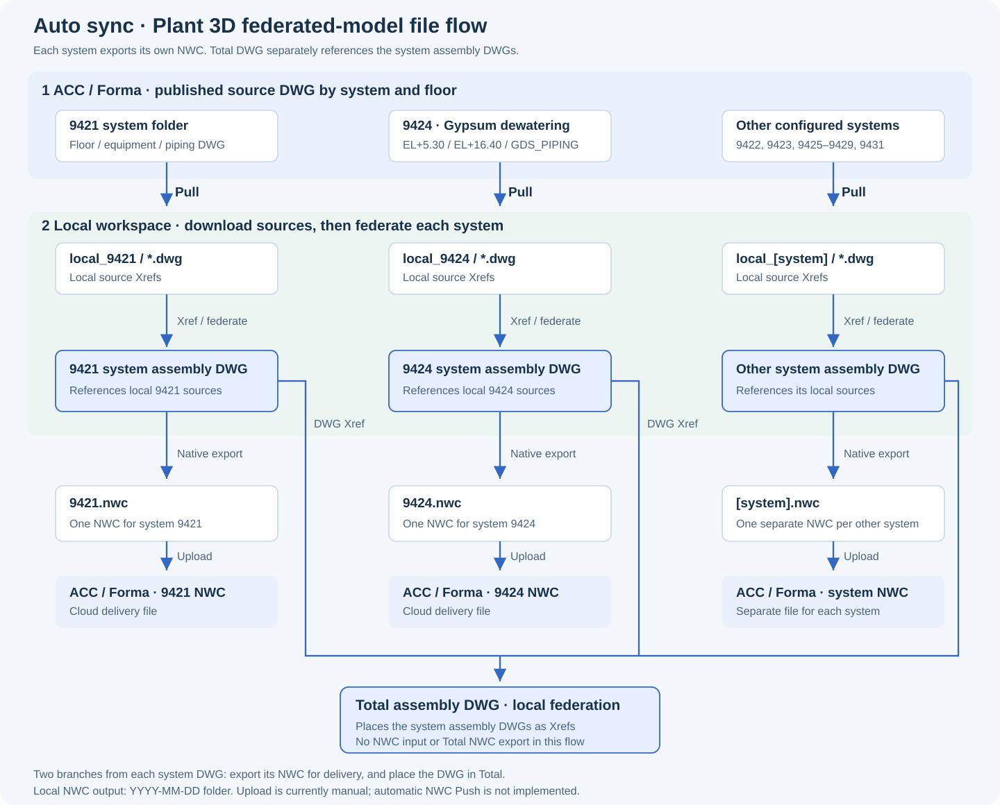

# Plant 3D Auto sync for Federated Models

**云端分楼层 DWG → 本地系统总装 → 每个系统各自导出 NWC → 上传云端 → 由各系统 NWC 组装非本地的 Total 总装。**

Auto sync 是用于 **AutoCAD Plant 3D 2024 / Windows x64** 的本地插件。当前源码版本 **0.4.15**，交互命令 `SYNC`，通过 Desktop Connector 获取云端发布文件，不需要 APS Client ID。

## 为什么需要 Auto sync

项目的 SO 要求模型按楼层拆分交付，同时还需要各系统的本地总装模型，以及由各系统 NWC 组装的 **非本地 Total 总装**。

如果只有分楼层文件，ACC / Autodesk Forma 与 Desktop Connector 的文件同步就足够了。但系统总装需要在本地把若干楼层、设备和管道 DWG 作为 Xref 汇总，再分别导出 NWC；非本地的 Total 总装依赖 **9421–9431 范围内各系统上传后的 NWC**，不是本地系统 DWG。文件同步并不会自动完成这些总装、导出和交付步骤。

Plant 3D 在这个文件式协作流程中，没有可直接替代 Revit **Synchronize with Central** 的同等工作流。Auto sync 不是模拟 Revit 中央模型，而是把文件依赖链明确化，让重复的检查、Pull、总装更新和 NWC 导出可以自动化。

## 文件流：本地系统 DWG → 各系统 NWC → 非本地 Total



**关键关系：云端 DWG 下载到本地后，是本地总装的 Xref，不是直接拿云端总装替换本地总装。**

1. **获取源文件**：读取 Connector 中各系统文件夹的发布 DWG，与对应本地 Xref 比较。
2. **Pull 到本地**：下载需要更新或缺失的源 DWG，保留与系统对应的本地工作目录。
3. **更新系统总装**：各系统的总装 DWG 引用这些本地源文件，加载当前本地版本。
4. **导出与交付**：每个系统总装分别导出一个对应的 NWC，再上传到指定云端 NWC 文件夹。例如，9424 总装对应 9424 的 NWC，而不是把多个系统合成一份 NWC。
5. **非本地端组装 Total**：使用上传后的各系统 NWC 组成整体模型。Total 不属于本地 Plant DWG 总装目录，也不是引用本地系统 DWG 的另一个本地图纸。

系统编号以项目实际存在的目录为准；本示例使用 9421–9429 和 9431，不预设缺失编号必须有模型。图中箭头表示文件依赖与目标处理顺序，不代表当前版本已实现全部环节的无人值守编排。

### 9424 系统示例

```text
Connector / Plant 3D Models / 9424_GYPSUM DEWATERING SYSTEM
  ├─ EL+5.30_1st Storey.dwg
  ├─ EL+16.40_2nd Storey.dwg
  └─ GDS_PIPING.dwg
                │ Pull：云端发布文件为准
                ▼
Local / Models / local_9424_GYPSUM DEWATERING SYSTEM
  └─ 对应的本地 Xref DWG
                │ Xref：本地组合，不 Bind 源图
                ▼
Local / Models / 单系统总装文件 / M-9424_GYPSUM.dwg
                │ Native NWC export
                ▼
Local / NWC TO UPLOAD / YYYY-MM-DD / M-9424_GYPSUM.nwc
                │ Upload
                ▼
ACC / Forma / 9424 的 NWC
                │ 与其他系统上传后的 NWC 一起组装
                ▼
非本地 Total 总装
  ├─ 9421 的 NWC
  ├─ 9424 的 NWC
  └─ 其他系统的 NWC
```

以上是便于阅读的示意名称，实际使用完整的项目文件名与人工确认的路径。**本地总装使用 DWG Xref；非本地 Total 使用各系统 NWC。** 此处不把 Total 标为 DWG，也不假定其具体文件格式、协同平台或自动组装机制；它是上传之后的项目协同环节。

## 当前功能与边界

| 环节 | 当前版本 |
| --- | --- |
| 本地总装列表、单份 / 勾选批量检查、进度条 | 已实现 |
| 云端 / 本地 Xref 对比、日期差、缺失文件提示 | 已实现 |
| Pull 更新、单文件下载、确认后新增 Xref | 已实现 |
| 唯一可确认的旧路径本地化、歧义保护、原生引用名显示 | 已实现 |
| 强制刷新自动映射，保留人工文件 / 文件夹对应 | 已实现 |
| 当前本地模型原生 NWC 导出、按日期归档 | 已实现 |
| 更新日志、问题表格、本地 / 云端 NWC 日期比较 | 已实现 |
| 独立 Plant 进程的批处理入口 | 已实现；定时触发需另行配置 |
| 使用上传后的各系统 NWC 组装非本地 Total | 外部协同环节，非当前插件功能 |
| NWC 导出后自动 Push 云端 | 尚未实现；当前手动上传 |

右侧 Xref 清单以云端文件为重点：

- **绿色置顶**：两端文件匹配且已引用。绿色不等于文件已是最新版，日期差仍显示。
- **黄色其次**：云端存在但本地缺失，或两端都有但尚未引用；旧引用路径失效也提示处理。
- 仅本地、云端缺失或对应不确定的条目不会冒充绿色。

## 使用

1. 构建并安装插件，重启 Plant 3D，运行 `SYNC`。
2. 点击“目录”，分别指定 Connector 源目录、本地模型根目录、系统总装目录和 NWC 输出目录。
3. 勾选总装，点击“检查所选”；右侧查看其本地 / 云端 Xref。
4. 使用“更新所选”，或单独下载 / 引用右侧文件。新引用的定位和比例需确认，不要假定所有项目共用一个坐标。
5. “导出 NWC”导出当前本地模型，输出到 `输出根目录/YYYY-MM-DD/`；日期按新加坡时间计算。
6. 将需要交付的 NWC 上传云端。自动上传不是本版已完成的功能。

“更多 → 强制刷新”重建自动目录映射及读取缓存；不删除人工规则，不自动 Pull 或改图。“查看问题”和“更新日志”提供表格诊断。

## 构建和验证

需要 Windows、支持 .NET Framework 4.8 的 .NET SDK，以及本机合法安装的 AutoCAD Plant 3D 2024。Autodesk 程序集从本机安装目录引用，**仓库不分发 Autodesk DLL**。

```powershell
# 在仓库根目录执行；仅打包，不修改已安装插件。
.\build.ps1

# 安装到当前用户的 Autodesk ApplicationPlugins。
.\build.ps1 -Install

# 隔离回归，不需要读取真实项目 DWG。
.\test.ps1
```

非默认安装目录可先显式构建：

```powershell
dotnet build '.\src\Plant Model Sync\PlantModelSync.csproj' -c Release '-p:AutoCADDir=D:\Autodesk\AutoCAD 2024'
```

源码包含 **574 项隔离回归检查**。验证使用假 DWG 读取器、真实文件操作和 WinForms，不能据此声称已在任意 Plant 会话或任意真实项目上验证通过。原生 NWC 导出需要在目标 Plant / Navisworks Exporter 环境中验证。

## 目录与维护

```text
README.md                       项目背景、文件流与使用说明
docs/assets/file-flow.svg       首页流程图，可直接维护
docs/file-flow.mmd              Mermaid 版依赖图
docs/automation.md              批处理配置与自动化边界
build.ps1 / test.ps1            仓库入口
src/Plant Model Sync/          插件源码、批处理脚本、隔离测试
src/Shared/                    插件所需的共用界面与表格控件
```

此仓库从本地开发项目提取当前功能源码，保留现有命名空间。个人路径预设已改为恢复已保存配置；旧 APS 认证代码、个人配置、历史宿主操作脚本、真实 DWG / NWC、运行日志及编译产物不发布。原本机部署不因这次发布而改变。

安全边界与配置见 [自动化说明](docs/automation.md)。尚未指定代码许可证；Autodesk 产品、SDK 及组件仍受各自许可约束。
